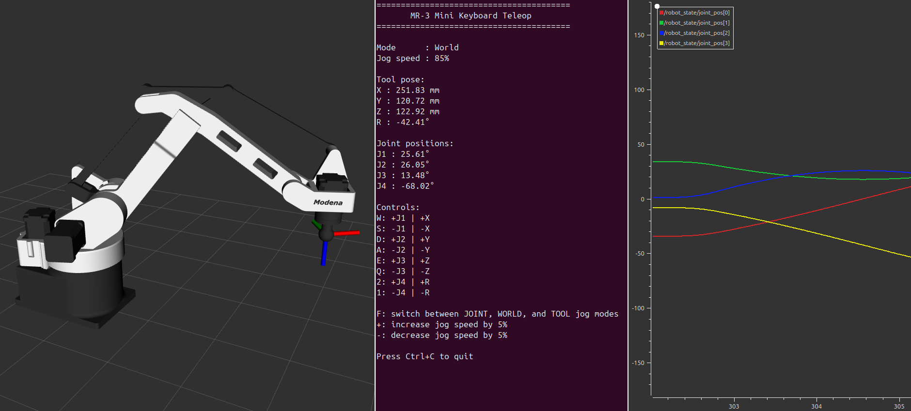
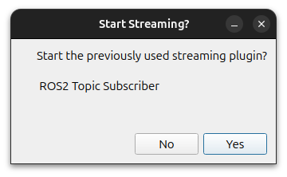
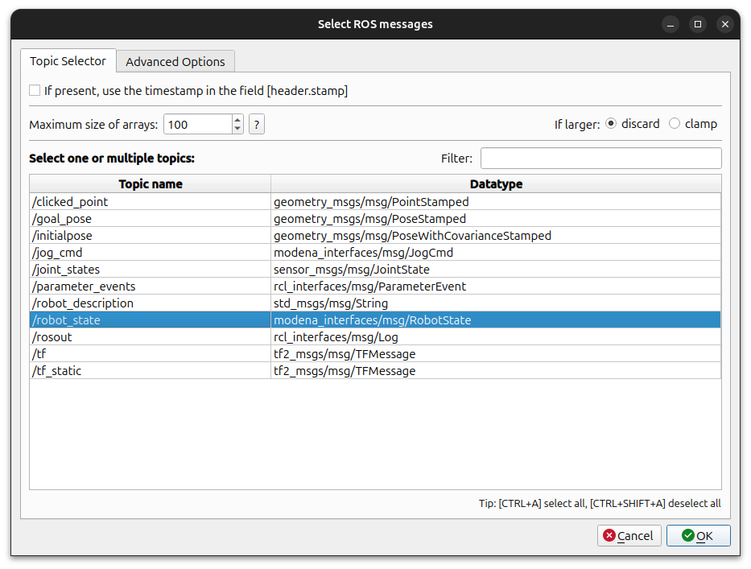

# MR-3 Mini Driver
ROS 2 driver for the MR-3 Mini palletizing robot.

This package provides communication between ROS 2 and the MR-3 Mini robot controller.

It publishes the robot state, receives jog commands, and provides action interfaces for executing robot instructions.

To jog the robot, start the `keyboard_teleop` node from the `modena_teleop` package after launching the driver.



## Features
- Serial communication with the MR-3 Mini controller
- Joint state publishing
- Robot state publishing
- Receives jog commands from ROS 2 nodes
- HOME and REST motion actions
- Joint and linear motion actions
- Motion result reporting
- RViz visualization
- PlotJuggler integration

## Installation
This package assumes an existing ROS 2 workspace.

Clone the repository into your workspace:

```bash
cd ~/ros2_ws/src
git clone https://github.com/modena-robotics/mr3_mini_driver.git
```

Build the package:

```bash
cd ~/ros2_ws
colcon build --packages-select mr3_mini_driver
source install/setup.bash
```

## Launch
Before launching the driver, connect the PC to the MR-3 Mini controller (ESP32) using a USB cable.

Launch the driver and visualize the MR-3 Mini model in RViz:

```bash
ros2 launch mr3_mini_driver bringup.launch.py
```

The launch file starts:

- `mr3_mini_driver`
- `robot_state_publisher`
- RViz

Optionally, PlotJuggler can also be launched to visualize joint positions in real time:

```bash
ros2 launch mr3_mini_driver bringup.launch.py show_plotter:=true
```

After launching PlotJuggler, a new small pop-up will open. Select the first pop-up and press `Enter` twice, or click `Yes` in the first window and `OK` in the second:

<table>
<tr>
<td valign="top">



</td>
<td valign="top">



</td>
</tr>
</table>

PlotJuggler will then open and start plotting joint positions from `RobotState` messages.


## Published Topics
| Topic | Message Type | Description |
|--------|--------------|-------------|
| `/joint_states` | `sensor_msgs/JointState` | Joint positions (rad) |
| `/robot_state` | `modena_interfaces/RobotState` | Joint positions (deg) and tool pose (mm, deg) |

## Subscribed Topics
| Topic | Message Type | Description |
|--------|--------------|-------------|
| `/jog_cmd` | `modena_interfaces/JogCmd` | Jog commands from teleoperation |

## Action Servers
| Action | Action Type | Description |
|--------|--------------|-------------|
| `/move_j` | `modena_interfaces/MoveJ` | Move the robot to the specified Cartesian pose using a joint-space trajectory |
| `/move_l` | `modena_interfaces/MoveL` | Move the robot to the specified Cartesian pose pose using a linear trajectory |
| `/move_abs_j` | `modena_interfaces/MoveAbsJ` | Move the robot to the specified absolute joint positions using a joint-space trajectory |
| `/move_home` | `modena_interfaces/MoveHome` | Move the robot to the HOME position at the specified speed |
| `/move_rest` | `modena_interfaces/MoveRest` | Move the robot to the REST position at the predefined speed |

All motion actions return a `move_result` indicating the outcome of the requested motion.

## Dependencies
This package depends on:

- `modena_common`
- `modena_interfaces`

The `bringup.launch.py` launch file also requires:

- `mr3_mini_description`

To control the robot using the keyboard, also install:

- `modena_teleop`

## Compatibility
Tested with ROS 2 Jazzy.

## License
This project is licensed under the BSD 3-Clause License.